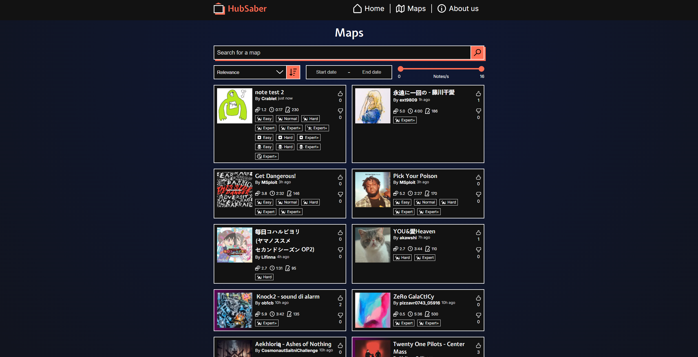

# HubSaber


### **The collective hub for all of Beat Saber's custom maps**

HubSaber is a platform for viewing all the different custom maps for Beat Saber made by the community, including information about them and leaderboards.

## What you can do with HubSaber
- Search, sort and filter through thousands of maps.
- View extencive information about a map, like tags, status, difficulties, and more.
- Each map contains leaderboards with the top scores for each difficulty.

## Technologies
- Next.js
- TypeScript

## APIs
- [BeatSaver Search API](https://api.beatsaver.com/docs/index.html#/Search/get_search_text__page_) for getting maps through an assortment of query parameters.
- [BeatSaver Map API](https://api.beatsaver.com/docs/index.html#/Maps/get_maps_id__id_) for getting details of a specific map.
- [ScoreSaber Leaderboards API](https://scoresaber.com/api/docs#description/tag/leaderboards/GET/api/v2/leaderboards/hash/{hash}) for getting the leaderboard IDs for each of a map's difficulties, and the game mode and difficulty to order the data correctly in line with BeatSaver's.
- [ScoreSaber Scores API](https://scoresaber.com/api/docs#description/tag/leaderboards/GET/api/v2/leaderboards/{id}/scores) for getting the top scores of a given difficulty.

## Usage
The APIs used are open to the public, so no keys or env variables needed
### Install Packages
```
npm i
```

### Start the app
```
npm run dev
```

## Known issues & missing features
- Filters button got removed due to time constraints.
- Date inputs have a few issues, like date picker closing when switching months, or start-date being able to be set after end-date, but fixing these issues would require rebuilding the inputs entirely, or having to build a custom date picker.
- The scoresaber api only gets the top 12 scores by default.
- Scoresaber api sometimes fails if it has to make too many requests at the same time, if a map for example has something like 20 difficulties. These are very rare though, and refreshing the page once or twice makes the requests pass.
- The difficulties should optimally be sorted by difficulty (expert+ first), while keeping the characteristic/gamemode order the same (standard first), but this got left out due to time.